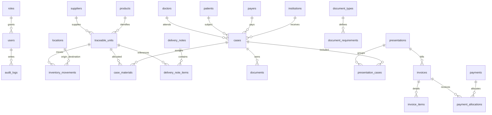

# Modelo de datos y diccionario resumido

| Tabla | Campos principales | Integridad e índices |
|---|---|---|
| `users`, `roles`, `audit_logs` | UUID, rol, actor, evento, antes/después, fecha | `audit_logs(entity_type, entity_id, created_at)`; sólo inserción. |
| `products` | sku, gtin, descripción, requiere_lote, requiere_serie | `UNIQUE(sku)`, `UNIQUE(gtin) WHERE gtin IS NOT NULL`. |
| `suppliers`, `institutions`, `payers` | razón social, CUIT, contacto/reglas | `UNIQUE(cuit)` normalizado. |
| `patients`, `doctors`, `locations` | identificador interno / matrícula / tipo | paciente: `UNIQUE(internal_id)`; acceso por política. |
| `traceable_units` | producto, proveedor, lote, serie, vence, costo, moneda | `UNIQUE(product_id, serial) WHERE serial IS NOT NULL`; vencimiento indexado. |
| `inventory_movements` | unidad, tipo, origen, destino, motivo, documento, actor, fecha, reversa_de | FK y `CHECK` para motivo por ajuste/baja/devolución; índice `(unit_id, occurred_at DESC)`. No UPDATE/DELETE. |
| `delivery_notes`, `delivery_note_items` | número, tipo, origen/destino, conformidad; unidad | `UNIQUE(number)` y `UNIQUE(delivery_note_id, unit_id)`. |
| `cases`, `case_materials` | número, tipo, paciente, pagador, estado; unidad/estado | `UNIQUE(case_number)`; único parcial de unidad en asignaciones activas. |
| `document_types`, `documents`, `document_requirements` | tipo, hash, estado, vínculo; requisito por gestión | `UNIQUE(sha256)` opcional; requisitos únicos `(management_type, document_type_id)`. |
| `presentations`, `presentation_cases` | pagador, período, ventana, estado; captura | `UNIQUE(payer_id, period)`; único parcial para caso en presentación activa. |
| `invoices`, `invoice_items`, `payments`, `payment_allocations` | número, vencimiento, importe; imputación | `UNIQUE(number)`; `CHECK(amount > 0)`; saldo calculado por asignaciones. |
| `price_lists`, `exchange_rates` | vigencia, moneda, valor | únicos por lista/producto/vigencia y moneda/fecha. |

Restricciones adicionales: trigger que bloquea movimiento de consumo si ya existe uno válido para la unidad; trigger que bloquea consumo vencido sin `override_authorized_by`; política que impide borrar transacciones. Las anulaciones generan movimiento/registro inverso enlazado por `reversa_de`.
