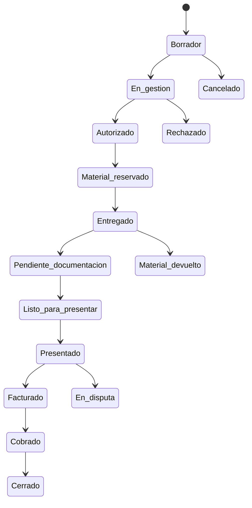

# Estados, permisos y flujos

## Transiciones



| Dominio | Estados | Transición relevante |
|---|---|---|
| Unidad | disponible, reservado, consignado, entregado, consumido, devuelto, cuarentena, vencido, baja | `consumido` es terminal; sólo corrección por anulación auditada. |
| Documento | pendiente, cargado, validado, rechazado, vencido | Sólo validador autorizado puede pasar a validado. |
| Presentación | abierta, en preparación, presentada, observada, cerrada | Caso sólo una presentación activa. |
| Factura | borrador, emitida, anulada, vencida, cobrada parcialmente, cobrada | Cobros imputados actualizan saldo derivado. |

## Matriz de permisos

| Rol | Capacidades |
|---|---|
| Administrador | maestros, usuarios, reglas, correcciones aprobadas y auditoría. |
| Compras/Stock | recepción, traslado, cuarentena, bajas y vencimientos. |
| Logística | remitos, entregas, devoluciones y consignaciones. |
| Gestión de casos | casos, reserva, consumo con evidencia, documentos. |
| Facturación/Cobranzas | presentaciones, facturas, pagos e informes financieros. |
| Auditor/Lectura | lectura y auditoría; PII sólo con autorización documentada. |

## Flujos principales

1. **Recepción:** Stock registra proveedor, unidad, lote/serie y vencimiento; se crea movimiento de recepción.
2. **Consignación:** Logística crea remito, transfiere de depósito a banco institucional y solicita conformidad.
3. **Caso:** Gestión ingresa pagador, destinatario, paciente y autorización; reserva y entrega unidad existente.
4. **Consumo:** sólo unidad entregada, vigente y en ubicación correcta; se registra actor, hora, evidencia y enlace al caso.
5. **Presentación:** sistema evalúa consumo, checklist validado, período y exclusividad; guarda snapshot al presentar.
6. **Cobro:** Finanzas imputa importes positivos; el saldo se calcula como factura menos imputaciones.

## Wireframes funcionales

```text
┌ Sidebar ────┐ ┌ Dashboard ──────────────────────────────────────────┐
│ Dashboard   │ │ [Disponible] [Consignado] [Reservado] [Vencimientos] │
│ Casos       │ │ Casos que requieren atención | Presentación vigente  │
│ Stock       │ │ Alertas de vencimiento / documentación                │
│ Remitos     │ └─────────────────────────────────────────────────────┘
└─────────────┘

Caso: encabezado + progreso | datos | checklist documental
                              | material con lote/serie | acciones seguras

Unidad: identificación + ubicación | línea de tiempo inmutable de movimientos
```

El prototipo implementa estas pantallas y permite recorrer el flujo de demostración desde la interfaz.
